# FPV Drone Survivor

A cooperative PvE shooter for VRChat. Up to 6 players cross a 100 x 100 m map from Point A to Point B while a swarm of networked flying drones hunts them.

Built with Unity and UdonSharp, this project features realistic AI-driven drones, realistic ballistic bullets, two-handed VR firearms, a stamina system, and a difficulty system that scales the whole threat, all synchronized across players.

https://vrchat.com/home/world/wrld_2aeadf62-ee1b-43d8-b26a-811ad68d75f2/info

---

## Screenshots

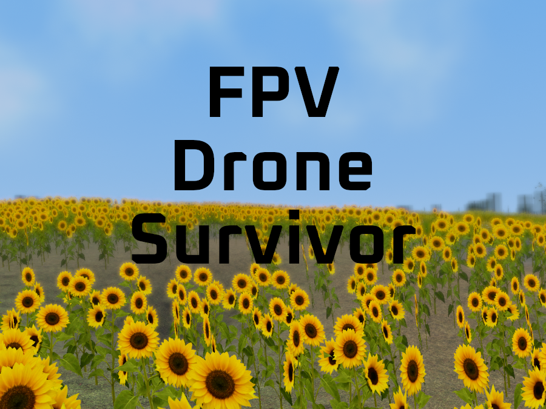

---

## Overview

FPV Drone Survivor World is a VRChat world built around one question: How horrible is drone warfare?

Players join the game from an in-world canvas, grab a rifle or shotgun at the start area, and move from Point A to Point B across forest and fields. Drones are spawned in waves based on where players have been seen by spotter drones, and they get more numerous as the difficulty goes up. Everyone has 1 HP, and so does every drone. The drones play fair: none of them cheat. They have no wallhack and only react to players they can actually see.

The project focuses on AI behavior, multiplayer synchronization, and a lightweight, optimized ballistic system within the limits of VRChat's Udon environment.

---

## Features

- **Three drone types** – Chasers (FPV-style kamikaze drones), Droppers (high-altitude bombers) and Spotters (fixed-wing recon).
- **Difficulty 0-5** – Set from a world-space canvas by the Game Host. 0 stops the game and resets every drone.
- **Game Host system** – Anyone can claim the Game Host role. The Game Host's client runs all drone AI, everyone else only displays.
- **Player roster** – Up to 6 playing players. Everyone else is an observer and is ignored by drones but they can shoot the drones too.
- **Realistic ballistics** – Bullets simulated with gravity and a raycast per frame, no script per bullet. Shotgun pellets lose speed with distance.
- **Two-handed firearms** – Rifles and shotguns share one script. Rifles are full-auto, shotguns fire a fixed 9-pellet spread.
- **Ammo and reload** – Magazine and chamber capacity, reload times, and VR or desktop reload input.
- **Swappable sights** – Iron, holographic and a zoomable scope. Shoot a sight cube to change the sight on the gun you are holding.
- **Stamina system** – Running drains stamina and exhaustion forces you to walk. Observers run freely.
- **Death and revival** – Killed players go to a "cemetery" and come back after a timer or by walking into a revive zone.
- **Minimap** – A top-down camera that renders on a timer instead of every frame.
- **Network optimized** – Spotters need almost no network traffic, and bullets are never synced one by one.
- **Fair optimized** – Spotters need almost no network traffic, and bullets are never synced one by one.
- **No cheating** – Drones have no wallhack and no radar. They only know where you are when they actually see you: view cone, range limit and line-of-sight raycasts, blocked by walls, trees and terrain. Hide, and they go to where they last saw you, not to where you really are.

---

## The Drones

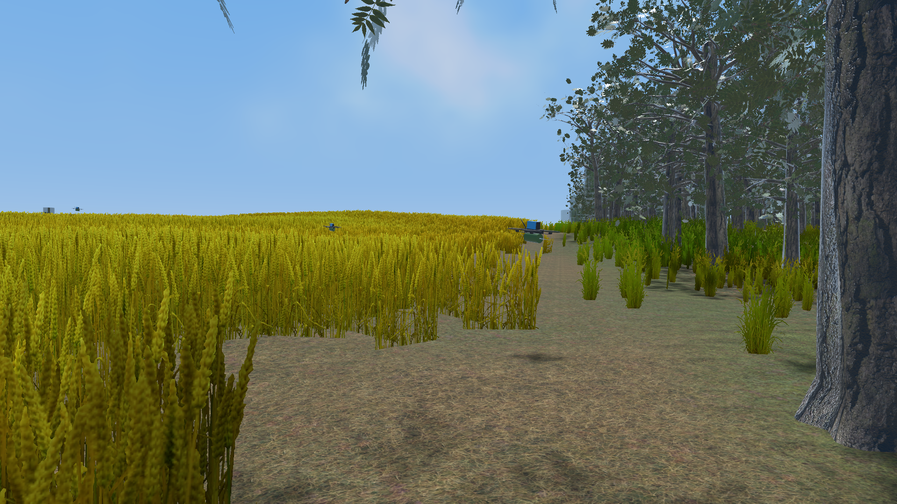

### Chaser
A quadcopter FPV Kamikaze drone that hunts players by sight. It flies on the NavMesh, patrols in a growing clockwise ring, and chases the last seen position of a player. Outdoors it commits to a fast dive at the player's feet. When it cannot dive (indoors, too close, no clear line) it rushes the player and detonates next to them.

States: `Parked`, `Travel`, `Patrol`, `Chase`, `Dive`, `Exploded`.

Notable behavior:
- Looks ahead for ceilings and door lintels and drops to a low flight height indoors.
- Flies through windows and over obstacles using NavMeshLinks.
- The blast kills inside a core radius through walls, and further out only with line of sight.
- Tilts like a small helicopter, including banking into turns.

### Dropper
A high-flying bomber drone that flies in a straight line (no NavMesh). It travels and patrols at 75 m, descends to 30 m above a spotted player, matches their velocity, and releases bombs when the player is not running. Bombs have no collider, so bullets cannot hit them, and every client simulates their fall from the synced start values. Once out of bombs it climbs to 50 m and circles the player as a close-range spotter. A shot Dropper only explodes visually.

States: `Parked`, `Travel`, `Patrol`, `Attack`, `Trail`, `Exploded`.

### Spotter
A fixed-wing scout flying a smoothed loop at 100 m. Its position is a pure function of server time, so nothing about its movement is networked. Each Spotter watches one area at a time and casts rays from its eye at four body points (head, chest, groin, shin). A shared meter per player fills faster when the player is closer, moving faster, or more exposed. A full meter reports the player's position to the Captain. A shot Spotter disappears for a cooldown and returns on its slot. The only synced data is a cooldown timestamp per Spotter.

### OpFor Captain
The enemy AI manager that decides where drones go. It stores the last spotted position of each player (the "intel"), targets the player closest to Point B, re-sends free drones, and launches waves from a random LaunchArea. Intel is wiped when a player dies, leaves, reaches Point B, or when it expires. Nothing launches until someone is spotted.

| Difficulty | Chasers (max) | Droppers (max) | Spotters |
|---|---|---|---|
| 0 | game stopped | game stopped | game stopped |
| 1 | 2 | 1 | 2 |
| 2 | 4 | 2 | 2 |
| 3 | 6 | 3 | 3 |
| 4 | 8 | 4 | 4 |
| 5 | 10 | 5 | 5 |

---

## How to Play

Open this world in VRChat: https://vrchat.com/home/world/wrld_2aeadf62-ee1b-43d8-b26a-811ad68d75f2/info

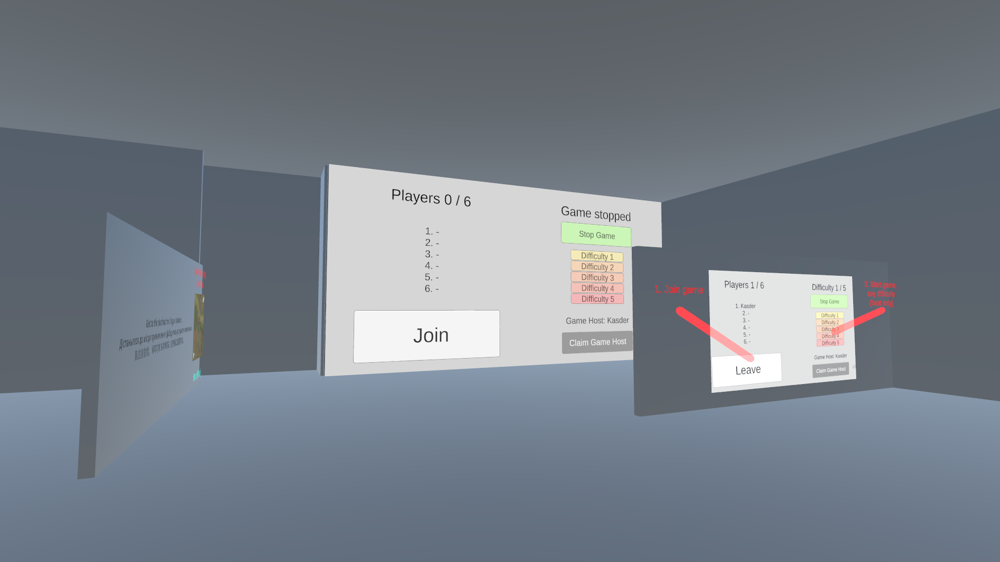

1. Use the world canvas to press **Join** and enter the game (max 6 players). Everyone else stays an observer.
2. Press **Claim Host** to become the Game Host. Only the Game Host can change the difficulty.
3. Pick a difficulty from 1 to 5 (0 stops the game).
4. Grab a rifle or shotgun at the start area. Shoot one of the three sight cubes to choose iron sights, holographic or scope.
5. Reload with the trigger on the magazine port (VR) or **F** (desktop).
6. Get from Point A to Point B without being spotted or killed.

If you die you are sent to the cemetery. You come back after 30 seconds, or sooner by walking into the revive zone near Point A.

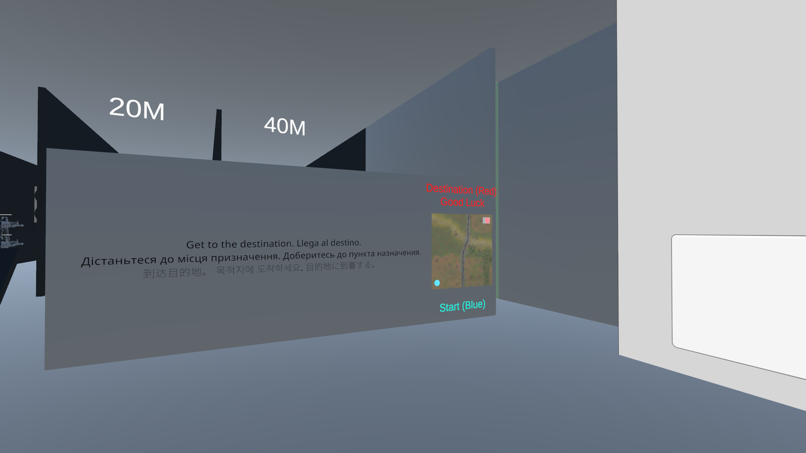
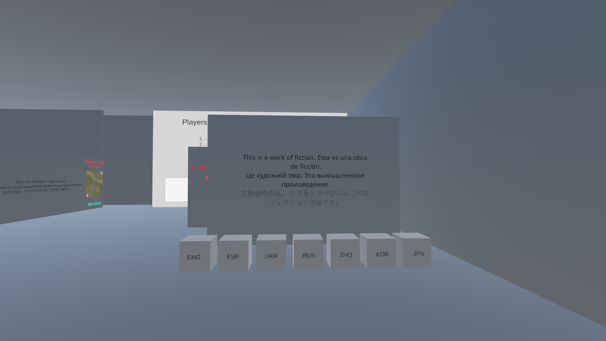
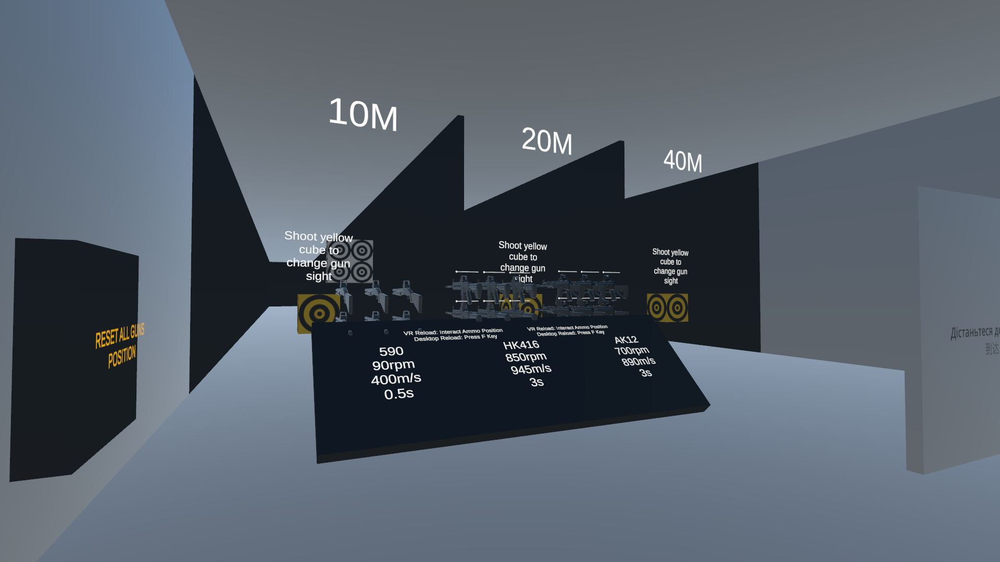

---

## Gameplay Systems

### Firearms
Rifles are full-auto with a 31-round capacity (30 per reload, 3 s reload). Shotguns hold 9 shells, load one per reload (0.5 s each) and fire a fixed ring of pellets. Both are the same `TwoHandGun` script with different inspector values. The guns cannot fire while reloading, and ammo resets when someone else picks the gun up.

### Ballistics
`BallisticManager` steps every active bullet once per frame with gravity and a raycast per segment. Hits are decided on the shooter's client, and the target decides what to network.

### Stamina
Running drains stamina nonlinearly, standing still recovers it fastest, and an exhausted player is limited to walking speed until they recover. A head-following world-space HUD works in both VR and desktop.

### Multiplayer
Every drone, gun and player system is designed for multiple players:

- The **Game Host's client** runs all drone AI.
- The **shooter's client** decides whether a bullet hit a drone.
- Each **player's own client** decides whether they were caught in a blast or touched by a drone, so there is no latency unfairness for the victim.
- Drones that fly freely use VRC Object Sync plus a small Manual-sync child object for their state. Spotters use server time instead.

### Fair Play
None of the drones cheat. Chasers and Droppers must see a player through their view cone and line-of-sight checks, and Spotters must see at least two of four body points. The Captain only knows where players are from these sightings, and a drone that loses sight of you goes to the last seen position, not your real one.

---

## Technical Details

| Component | Technology |
|---|---|
| Game Engine | Unity |
| Platform | VRChat |
| Scripting | UdonSharp / C# |
| Networking | VRChat Udon Networking, VRC Object Sync |
| Drone Navigation | Unity NavMesh and NavMeshLinks (Chasers) |
| UI | Unity UI / TextMeshPro (world-space canvases) |
| Scope | Second Camera + Render Texture |

---

## Project Structure

<!-- Update this section to match the actual repository structure -->

```text
Assets/
├── ALP_Assets/
├── Download/
├── Drone/
├── Gun/
├── Materials/
├── Procedural Skybox 2.0 Lite/
├── Realistic Tree/
├── Scenes/
├── ScriptDrone/
├── ScriptOther/
├── SerializedUdonPrograms/
├── Terrain/
├── TextMesh Pro/
├── Thumbnail/
├── UdonSharp/
├── YughuesFreeCobbleMaterials/
├── YughuesFreeConcreteMaterials/
└── YughuesFreeGroundMaterials/
```

### Scripts

| Script | Purpose |
|---|---|
| `GameManager` | Synced difficulty (0-5) and the Game Host role |
| `DifficultyUI` | Canvas buttons for difficulty and Claim Host |
| `PlayerRoster` / `PlayerSlot` | The 6 playing slots, Join/Leave, alive flag |
| `LocalPlayerState` | Local player's playing/alive state, Kill and Revive |
| `StaminaSystem` | Stamina, movement speeds and HUD |
| `ReviveZone` | Trigger that brings a dead player back |
| `TwoHandGun` | Rifle and shotgun: aim, fire, ammo, reload, sights |
| `GunReloadZone` | VR reload relay on the magazine collider |
| `GunSightSelect` | Shootable cubes that change the held gun's sight |
| `Scope` | Scope zoom from the slider |
| `BallisticManager` | Bullet and pellet simulation and hit detection |
| `OpForCaptain` | Intel, targeting and wave launching |
| `DroneChaser` / `DroneNetSync` | Chaser AI and its synced variables |
| `DroneDropper` / `DropperNetSync` | Dropper AI, bombs and its synced variables |
| `SpotterManager` / `SpotterHit` | All Spotters: movement, vision and being shot |
| `MapCameraRender` | Low-frequency minimap rendering |
| `PickupResetter` | Resets pickups (guns) to their start position |
| `TeleportOnInteract` | Simple teleport on Interact |
| `TestTarget` | Test cube for hit detection |

---

## Development Environment

<!-- Verify these match your current project -->

- Unity 2022.3.22f1
- VRChat SDK - Base 3.10.5
- VRChat SDK - Worlds 3.10.5
- VRChat Package Resolver Tool 0.1.29

---

## Installation

1. Clone or download this repository.
2. Open the project using the compatible Unity version.
3. Ensure the required VRChat SDK and UdonSharp packages are installed.
4. Open the main world scene.
5. Bake the NavMesh (needed by the Chasers).
6. Build and test using the VRChat SDK.

### Setup notes

- **Layers:** Drone hit boxes sit on layer 30 `OpFor`. Tick it in `BallisticManager`'s Hit Mask, and leave it out of the drones' obstacle masks.
- **BallisticManager Hit Mask:** Default, Environment and drone layers. Not Pickup, Player, PlayerLocal or UI.
- **Spotter vision mask:** Only the Default layer, so pickups, players and drones never block the rays.
- **Chaser and Dropper obstacle mask:** Walls, terrain, buildings and trees. Exclude player layers.
- **NavMeshLinks:** Place them on both sides of a window or obstacle so Chasers can pass through or climb over.
- **Scene objects:** Point B, two or more LaunchAreas, Spotter waypoints (children of one parent) and Spotter areas (children of another parent, X scale = radius).

---

## Configuration

Most behavior is tuned through the exposed Unity Inspector settings.

Examples include:

- Drones per wave, wave cooldown and drone respawn time (`OpForCaptain`).
- Flight heights, speeds, vision and blast radii (`DroneChaser`, `DroneDropper`).
- Minimum Spotter count, flight speed, shot cooldown and spotting speed (`SpotterManager`).
- Fire rate, muzzle velocity, ammo capacity, reload time and shotgun pellets (`TwoHandGun`).
- Auto-revive time and cemetery location (`LocalPlayerState`).

Each drone script also has debug options (ignore vision, kill any target, state logging) that must be set in the editor before building.

---

## Possible Future Updates????

- [ ] Optimize gun script network before adding more drones.
- [ ] Waiter drone: waits at a random spot and dives when a player enters its vision.
- [ ] Crasher drone: a fixed-wing that flies in from a launch area and crashes on a called location.
- [ ] Hover drone: searches, spots and follows, does not attack.
- [ ] Make Dropper fly back to "reload".
- [ ] More 3D models such as buildings, vehicles and trenches.
- [ ] Code clean up and more code comments.

---

## Known Issues

<!-- Document known bugs, limitations, or compatibility issues -->

---

## Credits

Developed by Kasder [Kasderian]. Someone took the GitHub Username Kasder already, lol.

My VRChat friends, thank you.

With the help of Claude, ChatGPT and Gemini.

---

## Third-Party Assets & Resources

https://assetstore.unity.com/publishers/4986

https://assetstore.unity.com/packages/3d/vegetation/trees/european-forests-realistic-trees-229716

https://assetstore.unity.com/packages/2d/textures-materials/nature/grass-flowers-pack-free-138810

https://assetstore.unity.com/packages/2d/textures-materials/sky/procedural-skybox-2-0-lite-332554

https://allpngfree.com/sunflower-plant-png-transparent-vhah

https://www.turbosquid.com/FullPreview/772551?dd_referrer=

https://polyhaven.com/a/burned_ground_01

https://sketchfab.com/3d-models/low-poly-ak-12-c4a69e36c59a480092d5ac91673713f0

https://sketchfab.com/3d-models/low-poly-hk416-059e968f6f764357880807c62c117ab7

https://sketchfab.com/3d-models/low-poly-mossberg-590-c0551a6b841145f7a8e59e9304728f1f

https://pixabay.com/sound-effects/film-special-effects-gun-reload-123781/

https://pixabay.com/sound-effects/film-special-effects-gunshot-352466/

https://www.youtube.com/watch?v=t4FoCnVLgag

https://pixabay.com/sound-effects/film-special-effects-medium-explosion-40472/

https://pixabay.com/sound-effects/musical-dry-field-grass-rustling-482893/

---

## License

<!-- Specify your chosen license here -->
Credit me and use it as how you like. Please don't break any laws or any rules to Unity and VRChat.

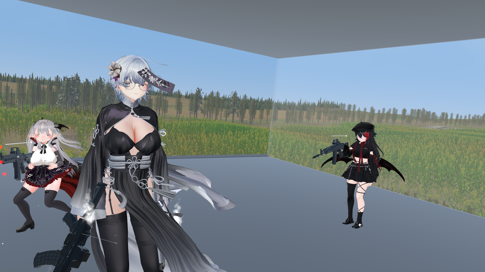
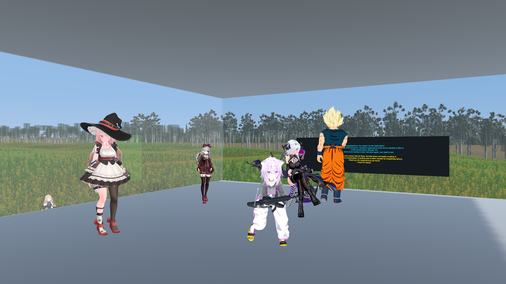
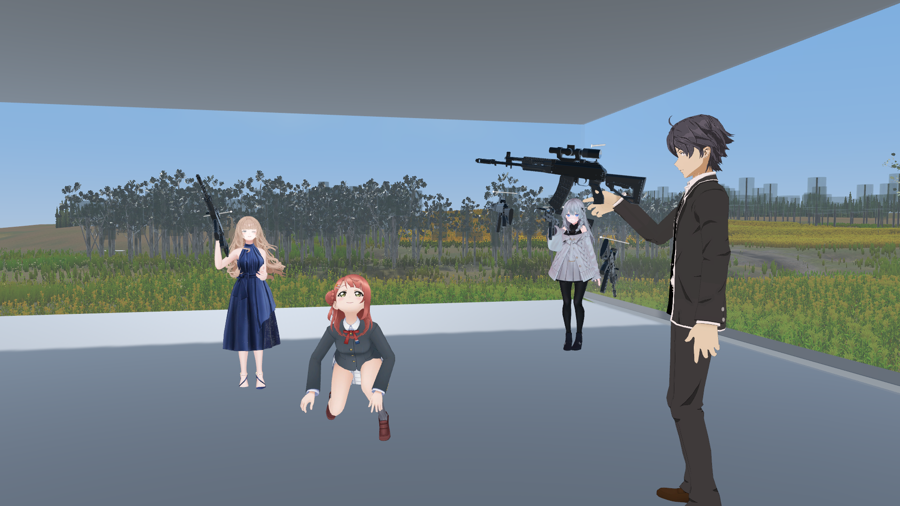
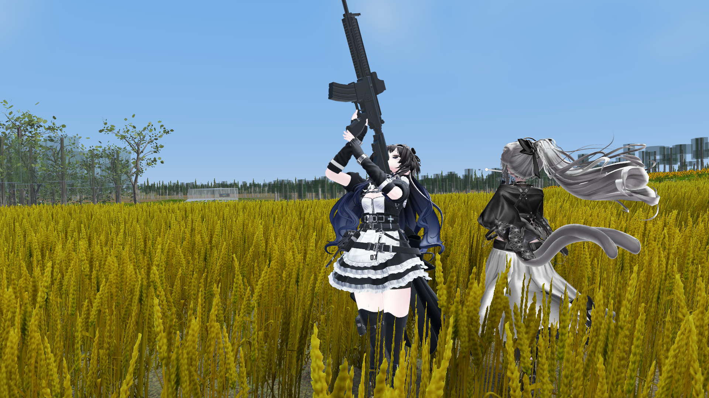
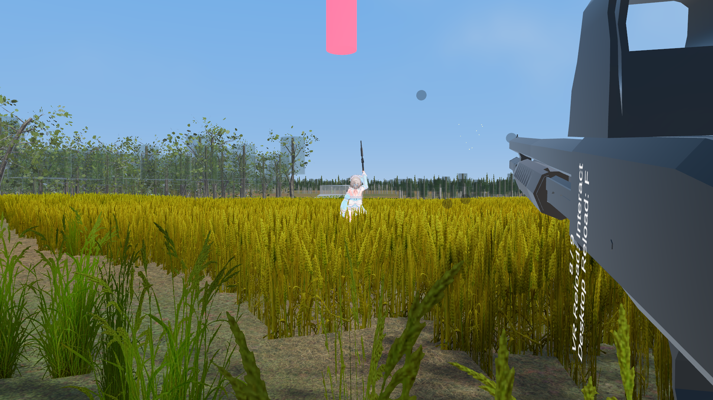
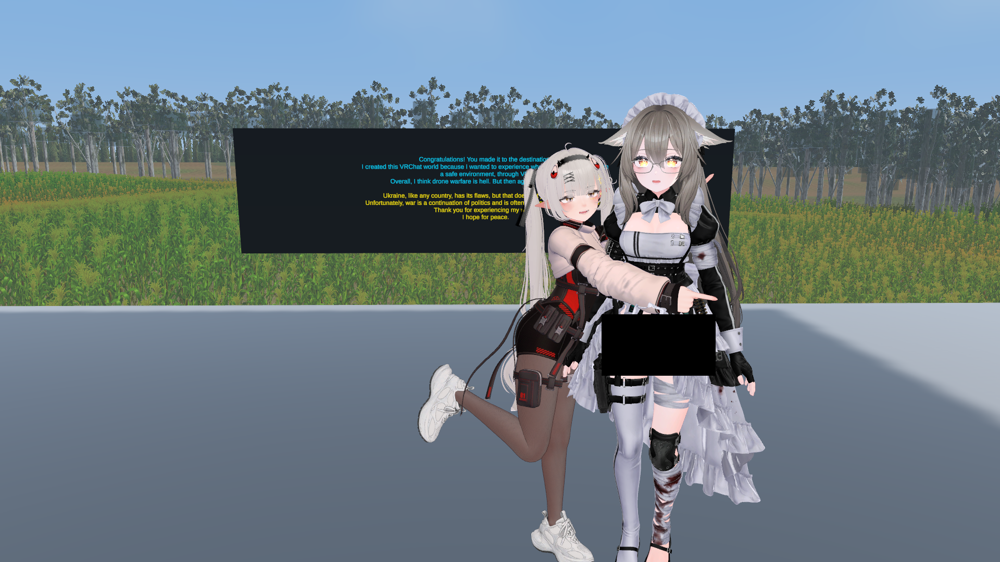
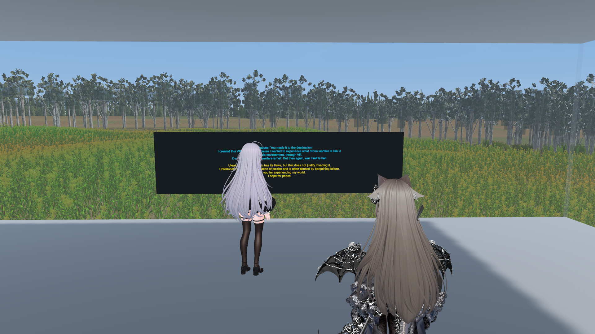
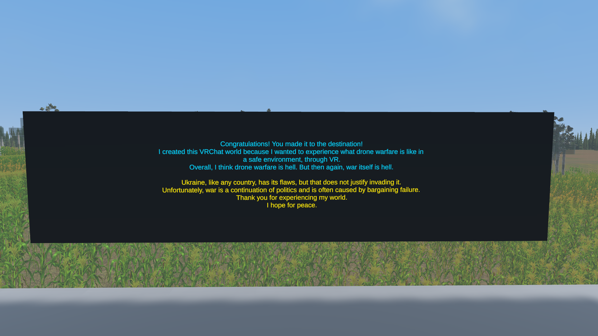


